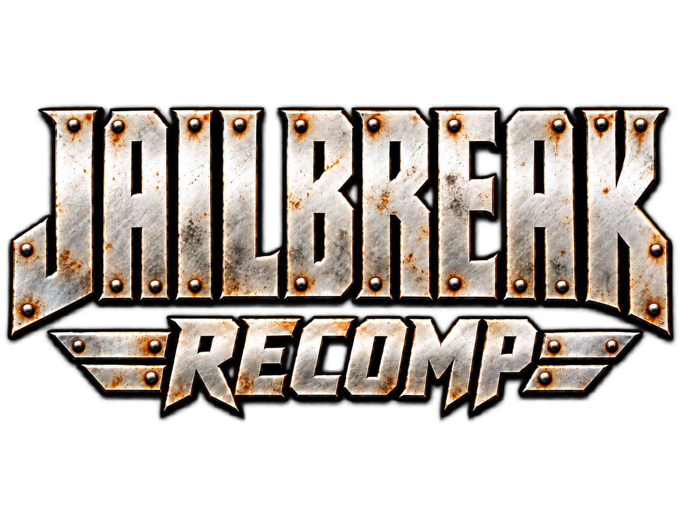
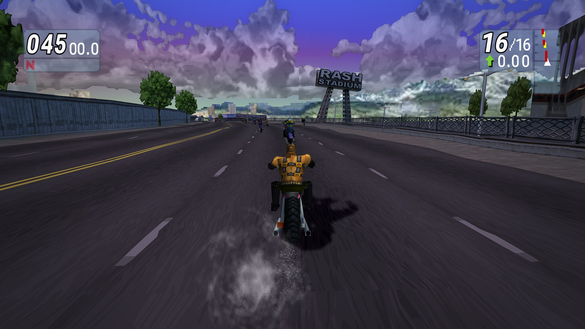
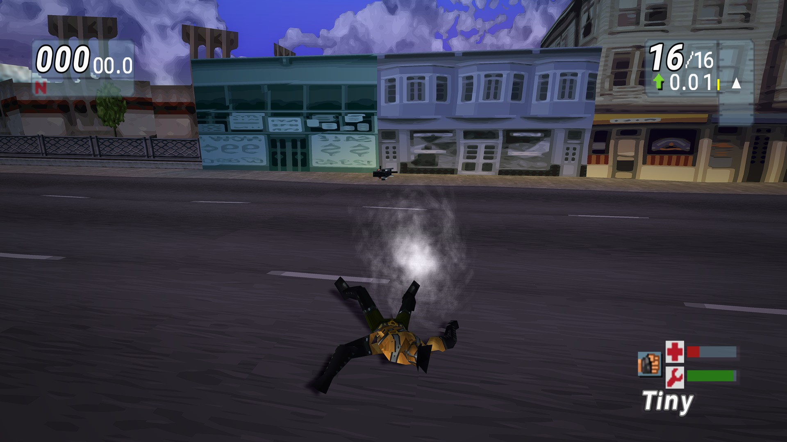
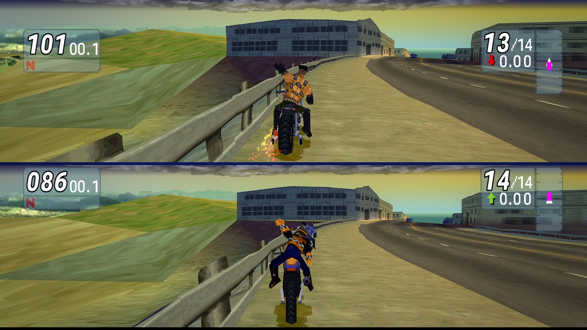
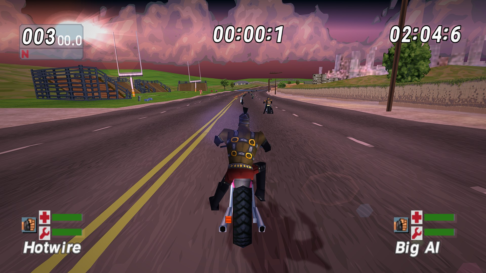
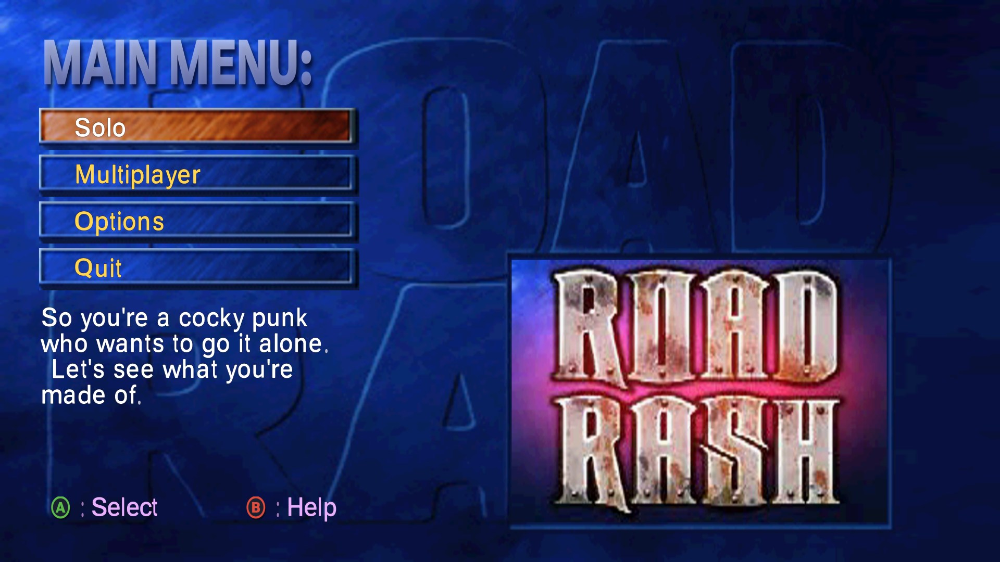
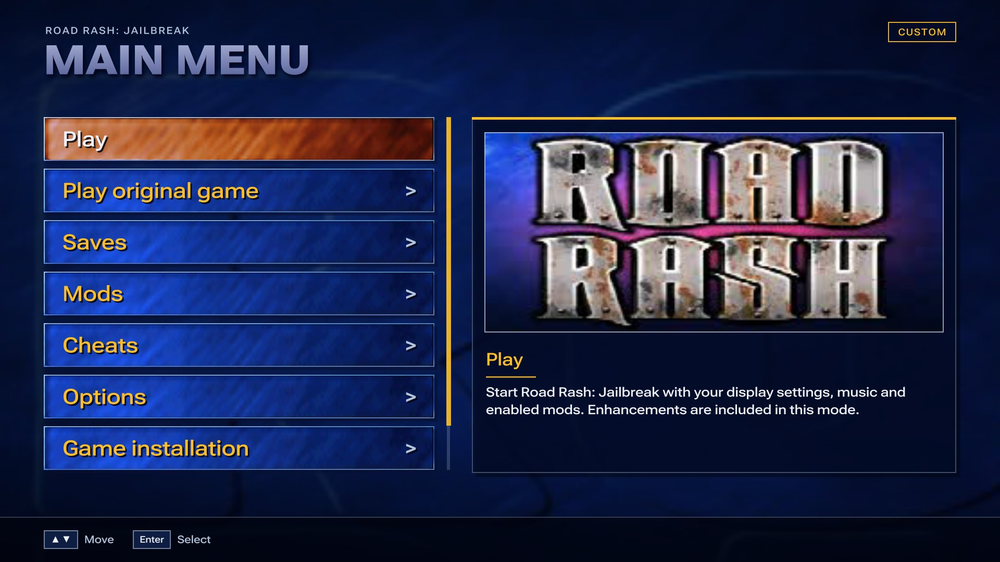

  

# Jailbreak Recomp

An unofficial native PC port of **Road Rash: Jailbreak** (PlayStation, 2000, USA version SLUS-01053), built by **static recompilation**. The PlayStation game code is translated into native C ahead of time and compiled for Windows, then run on the open-source [psxrecomp](https://github.com/RetroPortingToolKit/psxrecomp) runtime. It is not an emulator running the game image: the game runs as native code, which is what makes 60 and 120 FPS races, widescreen and the PC features below possible.

**You need your own copy of the game.** This repository contains no game code, no game assets and no Sony BIOS. The launcher reads your disc image, checks it is the supported USA game, and compiles the native game on your PC from it. Every picture, sound and word of the game you see in the launcher or the game is read from your own disc. Nothing from the game is ever downloaded or distributed.

## Why I made this

Road Rash: Jailbreak was one of my favourite games from my youth, and even after so many years I still end up coming back to it. I wanted a version that brings it up to date: proper PC features like high frame rates, widescreen and modern controllers, plus the in-game features I wished it had when it came out back in 2000. Everything new can be switched off. **Play original game** runs the game in all its 2000s glory, with a few optional extra settings.

## Screenshots

| | |
| --- | --- |
|  |  |
| *Widescreen race at 60 FPS, 1440p* | *Wrecked in the city, in full 16:9* |
|  |  |
| *Two-player split screen, filling the whole width* | *Time Trial with the HD HUD* |
|  |  |
| *The game's own menus with HD lettering* | *The launcher, dressed in art from your own disc* |

## Download and play

Get the latest **JailbreakRecomp_x.y.zip** from the [Releases](../../releases) page, unzip it, and run `RoadRashJailbreak.exe`.

1. **Find your game (.bin)**: pick your own disc image (single-track .bin/.cue or .iso, USA version). Until it passes the check, the launcher shows no game artwork at all.
2. The first setup downloads the pinned build tools (about 240 MB from the psxrecomp project's public releases) and the two small online libraries, then compiles the game and its online version side by side on your PC's cores. This takes about 15-25 minutes on a recent PC (longer on an older one), only the first time. Keep the window open.
3. Pick a setup (Recommended, Classic look or High end) and press **Play**.

Requirements: Windows 10 or 11 (64-bit), about 8 GB of disk space, and an internet connection for the first setup (and for online play). After that the game runs offline and the disc image is no longer needed. Data lives in `%LOCALAPPDATA%\RoadRashJailbreak`.

**Coming from 1.0 or 1.1?** Unzip 1.2 to a new folder and run it. The first **Play** rebuilds your game with the 1.2 changes (the tools are already there, so it's quicker), and your saves and settings stay. From 1.2 on, the launcher updates itself: **Game installation → Check for updates** (it also checks once a day).

Some antivirus programs (Norton, for example) hold a newly built, unsigned exe on its first launch, so the game looks frozen. The launcher warns you when that can happen. Wait, or close it and press Play again, or add an exclusion for that folder.

## What's new compared with the PlayStation version

### Frame rate and performance
- **Native 60 FPS races.** Real game frames at the original game speed, with no interpolation or frame generation. The PS1 ran races at about 20 FPS.
- **120 FPS mode** for 120 Hz+ displays, much faster in 1.2. If a moment is ever too heavy, the game drops to 60 FPS for a few seconds and keeps its speed; if two races in a row can't hold 120, it stays at 60 for the session and suggests a lower render resolution. **Precise vertices** costs extra speed, so on most PCs it's best at 60 FPS.
- **Heavily optimised.** The emulated PS1 hardware does only the work a race can actually notice, and the build is profile-guided. A full 16-rider race has plenty of headroom at 120 FPS.

### Picture
- **Widescreen 16:9 and 21:9.** A real wider view of the road (projection-corrected, not stretched). The race HUD keeps each element at its screen edge, and split screen fills the width.
- **Render resolution** from native up to 4K, **anti-aliasing** (FXAA, FXAA HQ, 2x / 4x supersampling) and optional **scanlines**.
- **Texture filters:** Sharp (the PS1's own pixels), Smooth, or **xBR**, which rounds off blocky edges on signs, sky and HUD art.
- **Precise vertices:** none of the PS1's famous wobbling geometry and warping textures. Shapes and textures stay put.
- **Level of detail and draw distance.** Riders and bikes keep their full-detail models much further away, and traffic and riders stop popping in.
- **Effects** (all off to start): bloom, sharpening, livelier colour, vignette and **shadow smoothing** (soft-edged bike shadows instead of hard pixel steps).
- **HD menus and lettering** in the game's own style: menus, bars, title banners, race messages and the race countdown.
- **Display presets** (Recommended, Classic look, High end) and a first-run setup screen.

### Quality of life
- **Fast loading.** An emulated 4x disc drive, so races load in about half a second. Optional **intro skip**.
- **In-game PC menu** on the main menu's Options row and in the pause menu. Display (Screen, Picture, draw distance, Effects), riders, audio and system settings, all applied without leaving the game.
- **Saves browser.** Play, copy, export and import memory-card saves (.mcs), with each save's profiles listed. Jail Break saves show the rider you picked, with their portrait. Both cards are backed up automatically before every launch.
- **Quick resume.** Save and resume a race from the pause menu, or straight from the launcher.
- **Mouse in the game's menus.** Point at a row to select it, click to choose, right-click to go back, scroll to move.
- **Controllers.** The game's own analog setup on a modern controller (steer with the stick, throttle and brake on the right stick). The menus show your own keys or Xbox-style buttons instead of PlayStation icons, and keys and buttons can be rebound.
- **Two-player split screen** with two controllers, or a controller and the keyboard, and **up to four players in Side Car (Versus)**, as the game always allowed with a PlayStation Multitap. Multiplayer races now have the race music (the PS1 played none), a fair random start in the pack instead of side by side behind it, and no blue flashing on the other player's rider.
- **Play original game.** The untouched game, one click away, for comparison. It has its own opt-in options (resolution, texture filter, fullscreen, widescreen, 60 / 120 FPS, Esc to quit), all off to start.
- **Report a problem.** Saves a ZIP with a picture of the launcher, recent logs and your settings (no game data).
- **Robustness.** If the game reaches code the static recompile missed, it keeps running (that code is interpreted) and logs the address, instead of crashing.

### Additions
- **Six beta courses restored.** The disc holds six courses the retail game never offered: **Meadows, Countryside, Alpine, Rash City, Cactus Hills and Coast**. They're raceable in Time Trial with their own records, and previewed with their original "polaroid" loading cards, also never shown in the retail game. Being unfinished beta courses, they appear to use their own fixed camera angles, which can't be changed, so a couple of the races are tricky to ride.
- **Your own rider name.** It always seemed odd that you were just "Player 1" or "Player 2" in races, so both riders can now have a proper name of your own, shown on the race HUD and results.
- **Taunt voices.** There are so many voice lines in the game, yet you were stuck with the default one (unless you were Player 2). You can now choose which character's voice lines your rider uses, with a preview of each.
- **Outfits.** Pick a gang and choose the rank appearance you'd like to ride as.
- **Rider colours.** A lot of rider textures on the disc go unused. These are now all selectable.
- **Bike paint and name tags.** A new colour for your bike's bodywork (chrome, tyres and decals keep theirs), and for your name under the health bars.
- **Your own music.** Import WAV tracks to replace the race music, also playable from the game's Jukebox.
- **Mods.** `.rrmod` packs can replace textures and UI art, sounds and 3D models, each switched on or off in the launcher. *Dump for modding* exports what your game uses. See [MODDING.md](MODDING.md).
- **Cheats.** GameShark codes (built-in and your own) and the game's own unlock codes. Achievements stay locked while a cheat is on.
- **26 achievements** to unlock, saved locally: finishing, winning, every mode, career ranks read from your saves and riding time, with progress and a reset. They stay locked while a cheat is on.
- **A launcher dressed in the game's own art.** Riders, gangs, cops, Spaz's story and the unused beta cards illustrate each option, all decoded from your disc at run time.
- **Discord presence** (optional; needs your own application ID in launcher.ini).

### Online
**Online** on the game's main menu, or **Multiplayer** in the launcher:
- **Play with friends.** Host a room and send its room code (RR-XXXXX-XXXXX). The router's port is opened automatically where it allows it (UPnP).
- **Public rooms.** Race strangers through the public lobby, after signing in with Discord (see below; room codes need no account).
- **Rooms of up to 8.** Two riders race as players, and players 3-8 each take over one of the AI riders in Skull-to-Skull. Rooms have chat.
- **Vote on the race.** Before each race everyone votes between three courses (course and rank picked at random).
- **Your bikes.** Set a bike for each rank, or leave it on Random for a random bike allowed at that rank.
- **Rating.** Everyone starts at 1000 (up to 9999). High finishes gain points and low ones lose some, scaled by your rating against the rest of the room and by how many are in it.
- A fair, random start in the pack for everyone. Rider names, taunt voices and rider looks show on every PC, and the music plays.

Every PC needs the same release, with mods and cheats off. Online has been tested with two players so far.

#### Why public rooms ask you to sign in with Discord
- **Only public rooms need it.** Playing with friends by room code needs no account at all.
- **The public room list isn't ours.** It runs on the shared recomp-net lobby server (`netplay.retcomm.net`), which several fan recomp projects use. This project can't run a server of its own. The lobby's operator requires a sign-in before anyone can list or join rooms, so that every room belongs to a real account. That keeps spam and abuse off a list shared with strangers, and lets bad actors be banned.
- **Discord does the sign-in, not this game.** The launcher opens Discord's own page in your browser. You approve there, and Discord shows exactly what it shares before you do (the lobby uses your Discord name in rooms). Your Discord password never reaches the launcher or the game.
- **Once per PC.** After you approve, the launcher saves a key for this PC in `%LOCALAPPDATA%\RoadRashJailbreak\netplay_secret`, so you aren't asked again. The key itself is never sent anywhere: the launcher proves it has it, and the lobby gives it a short-lived session. Treat the file like a password: don't share it or post it. **Report a problem** never includes it. To sign out, delete it.

## Controls

Every action can be rebound in the launcher: **Options → System → Controls**. Choose **Keyboard** or **Controller** for Player 1. Player 2 can use a second controller, or the keyboard while Player 1 is on a controller. **Up to 4 players in Side Car (Versus)**: set Player 3 and Player 4 to **Controller** there too, and the game gets a multitap with four pads (Player 1 can stay on the keyboard). Players on a controller get pads in the order the pads were plugged in, Player 1 first.

| Action | Keyboard (default) | Xbox-style controller (default) | PlayStation controller (default) |
| --- | --- | --- | --- |
| Accelerate | X | A | Cross |
| Brake | Z | X | Square |
| Steer left / right | Left / Right arrows | D-pad left / right, or the left stick | D-pad left / right, or the left stick |
| Primary attack | W | RB | R1 |
| Alternate attack | Q | LB | L1 |
| Kick | R | RT | R2 |
| Pause | Enter | Start / Menu | Options |
| Change camera | Right Shift | Back / View | Share (DualShock 4) / Create (DualSense) |
| Menu up / down | Up / Down arrows | D-pad up / down | D-pad up / down |
| The game's Circle / Triangle | S / A | B / Y | Circle / Triangle |
| The game's L2 | E | LT | L2 |
| The game's L3 / R3 | T / Y | Left / right stick click | L3 / R3 |

On a controller the game uses its own **analog** setup: the left stick steers, and the right stick accelerates (up) and brakes (down). In the game, **Options → System → Game options → Controller** switches between the game's Analog and Digital layouts, and shows every action with your own keys or buttons. The menus show your keys or controller buttons instead of the original PlayStation icons: Xbox-style letters for Xbox and other controllers, and Cross / Circle / Square / Triangle, L1-R2 and Options / Share / Create for a **DualShock 4 or DualSense** (also a DualShock 3). They follow the controller you last used, and switch when you plug in or use another. Buttons are matched by position, so the same mapping works on either kind of pad. The launcher can also be driven by a DualShock 4 or DualSense, over USB or Bluetooth.

**PC keys**

| Key | What it does |
| --- | --- |
| F6 | Opens or closes the PC menu (on the main menu or while paused) |
| Pause menu → **Options** | The PC pause page: text size and **quick resume** (save and load the race) |
| Alt+Enter or Ctrl+F | Fullscreen / window |
| Keypad + / − | Volume |
| F7 (in the Jukebox) | Import your own music |
| Esc (Original game only) | Closes the game, if you switched on **Esc closes the game** |

## Settings

The launcher's **Options** has four groups: **Display**, **User settings** (rider names, taunt voices, achievements, rider look), **Audio** (soundtrack, your own tracks) and **System** (Discord, loading speed, intro movies, controls, start-up). Most display settings can also be changed inside the game from the PC menu, and apply at once.

**Display → Preset** sets everything below in one go:
- **Recommended:** 1080p, 16:9, 60 FPS, HD menus and more detailed riders. Runs well on most PCs.
- **Classic look:** 4:3, the game's own frame rate and menus, drawn sharp.
- **High end:** 1440p, 16:9, 120 FPS, supersampling and the most detailed riders. Needs a fast PC and a 120 Hz screen.

Changing any setting shows **Custom**.

**System → Start-up → Straight to game** skips the launcher once you're set up: opening Jailbreak Recomp starts the game straight away, and the launcher closes with it. To get the launcher back, **hold Shift while opening it**. It also comes back by itself if the game can't start or stops with an error.

| Group | Setting | Choices (first = the original game) |
| --- | --- | --- |
| **Screen** | Render resolution | Native, 720p, 1080p, 1440p, 4K |
| | Window | Windowed, Fullscreen |
| | Aspect ratio | 4:3, 16:9, 21:9 (a wider view, not a stretch) |
| | Frame rate | Original, 60 FPS, 120 FPS (real frames at the original game speed) |
| | VSync | On, Off |
| | Low-latency input | On, Off (reads the controls just before each frame) |
| **Picture** | Texture filter | Sharp, Smooth, xBR (rounds off blocky edges) |
| | Precise vertices | Off, On (no PS1 wobble; costs some speed) |
| | Anti-aliasing | Off, FXAA, FXAA HQ, Supersample 2x, Supersample 4x |
| | Scanlines | Off, Light, Medium, Strong |
| | HD UI | On, Off (HD lettering and smoothed menus) |
| | HUD labels | Original, Large |
| | Movies | 4:3, Widescreen |
| **Detail** | Level of detail | Original up to 12x the distance at which riders and bikes keep full detail |
| | Draw distance | Original, 1.5x, 2x, 3x |
| **Effects** | Bloom, Sharpening, Colour, Vignette | Off, Light, Strong (races only, never on the HUD) |
| | Shadow smoothing | Off, Light, Strong (soft-edged bike shadows) |

The heavier choices (Supersample 4x, the highest levels of detail) are marked in the launcher's help with a warning.

**Play original game** has its own page, with every option off to start: resolution, texture filter, window, aspect ratio, frame rate (60 or 120 FPS, marked as not the original timing) and **Esc closes the game**.

## Where your files live

Everything is in `%LOCALAPPDATA%\RoadRashJailbreak` (paste that into File Explorer's address bar):

| File or folder | What it holds |
| --- | --- |
| `launcher.ini` | All your settings |
| `saves\card1.mcd`, `card2.mcd` | Your memory cards. `saves\backups` holds an automatic copy from before every launch |
| `saves\library` | Saves you've duplicated or imported (.mcs) |
| `mods\` | Installed mod packs |
| `music\` | Your own tracks |
| `achievements.ini` | Your achievements and progress |
| `reports\` | Bug reports from **Game installation → Report a problem** |
| `downloads\` | Build tools and updates, kept so later rebuilds work offline |
| `setup.log`, `build.log`, `build-online.log`, `runtime\runtime.log` | Logs from setup, the builds and the game |

To uninstall, delete that folder and the folder you unzipped. Copy `saves` somewhere first if you want to keep your progress.

## Questions

**The game looks frozen the first time I press Play.** That's usually antivirus (Norton, for example) checking the newly built game. Close it and press Play again, or add an exclusion for `%LOCALAPPDATA%\RoadRashJailbreak`.

**Setup says a build tool is damaged or "is not recognized".** Your antivirus removed one of the build tools while the game was compiling (Norton has done this with `cmake.exe`). Restore it from the antivirus's quarantine and add an exclusion for `%LOCALAPPDATA%\RoadRashJailbreak`, then choose **Game installation → Run setup again**.

**Setup failed.** The launcher says why in plain words (a full drive, antivirus, the wrong disc, a failed download). Fix that, then choose **Game installation → Run setup again**, which rebuilds the game from scratch (15-25 minutes; saves and settings stay). If it still fails, use **Report a problem** and attach the zip to an issue here.

**How do updates work?** Once a day the launcher asks GitHub for this project's latest release (nothing about you or your PC is sent). When there's a new one, **Game installation** shows **Update to version X**: it downloads it, checks it against GitHub's checksum, replaces the launcher's files and restarts. Saves, settings and your installed game stay; if the game itself changed, it rebuilds once on your next **Play**. To turn the daily check off, add `check=0` under `[update]` in `launcher.ini`.

**Which version of the game do I need?** The USA PlayStation release (SLUS-01053), as a single-track .bin/.cue or .iso. The launcher tells you if your disc image isn't the supported one.

**Do I need a PlayStation BIOS?** No. The game runs on OpenBIOS, the free open-source replacement.

**Does it work on Linux or Steam Deck?** It's built for Windows and hasn't been tested under Wine or Proton yet.

**Can I play online?** Yes, from 1.1: **Online** on the game's main menu. Everyone needs the same release.

**Online says the online game isn't built.** The setup builds it beside the main game and needs internet for its two libraries. Choose **Game installation → Run setup again**; `build.log` and `build-online.log` say why if it fails.

## Building from source

This repository is the release source: the launcher, the PC adapters that extend the runtime, the build recipes and the installer.

- **Launcher:** `Build-Launcher.ps1 -CompilerRoot <path to an LLVM-MinGW bin folder>` builds `RoadRashJailbreak.exe` (C11, clang).
- **The game:** built by the launcher on the player's PC from their own disc. The launcher downloads and checks the pinned toolchain in `recipe/toolkit.json` and unpacks it itself (no PowerShell). The toolchain's own Python then runs `tools/setup_game.py`, which fetches the pinned psxrecomp framework revision, builds the recompiler, and runs `tools/install_game.py`. That generates the native code from the disc, applies the recipes in `tools/` and compiles with `source/runtime-CMakeLists.txt`.
- **The online game:** a second build of the same sources (`-DRR_NETPLAY=ON`, eight seats, `source/rider_takeover.cpp`) into `runtime-netplay`, with recomp-net and rbengine downloaded at the commits pinned in `recipe/netplay.json`. Its fingerprint is a hash of the release's sources and the game, so players on the same release match and nobody else does.
- **Speed profile:** `recipe/game.profdata` is an LLVM profile (profile-guided optimisation) recorded from test races in the release build layout: Jail Break, Five-O, Time Trial, Skull-to-Skull, Side Car and the menus. It holds function names, relative source paths and run counts only, with no game code, data or personal paths, and the compiler uses it to lay out the hot code. To record your own, build with `RR_BUILD_PGO=gen`, play, and merge the `.profraw` files with `llvm-profdata merge`.
- **Reproducible:** the same disc gives every player a byte-identical game exe, wherever it's installed and however many jobs build it (relative compile paths via `tools/relpath_cc.py`, numbered link inputs via `tools/relpath_ld.py`, a fixed compile date, no time stamp, build-ID or symbol table, and no call-graph function sort at link time, which LLD does differently on every link). Each release's page lists the SHA-256 of the game's `runtime\RoadRashNativeResearch.exe` (1.1: `F2F403EFEBFEFF3EAA69552256865311B4BB84B312AB16D775877E3DE263FE1C`). `game-build-id.txt` beside the launcher fingerprints the game's sources (`tools/game_build_id.py`): an update that keeps it skips the rebuild.
- **Build speed:** the big generated units are compiled in pieces of up to 4 MB (`tools/fast_timing.py` split_pieces), with one job per CPU thread as memory allows, and the offline and online games build at the same time. The critical path is one huge game function (about 8 minutes) plus the ThinLTO link.

| Folder | What's in it |
| --- | --- |
| `source/` | Launcher (`launcher.c`, `launcher_skin.h`, `save_browser.h` ...) and the runtime adapters (`pc_services.cpp`, `rider_menu.cpp`, `native_ui.cpp`, `taunt_voices.cpp`, `demo_courses.cpp`, `mod_assets.cpp` ...) |
| `tools/` | Installer, framework recipes (`gpu_presentation.py`, `race_timing.py`, `fast_timing.py` ...), mod tools (`mod_manager.py`, `models.py`) |
| `recipe/` | Pinned toolkit and framework revision, the online libraries' pins (`netplay.json`), recompiler seeds, overlay profile, speed profile (`game.profdata`) |
| `licences/` | LGPL-2.1, psxrecomp's licence, SIL OFL for Roboto Flex, MIT for recomp-net and rbengine |

Never commit game files: disc images, extracted data, generated code, compiled game builds or saves. `.gitignore` blocks the usual ones.

## How this was made

Most of the code in this repository was written by **Claude**, Anthropic's AI model, working in Claude Code. That covers the launcher, the PC adapters, the online play, the installer and the build tools. I directed the project: I chose what to build and how it should look and feel, play-tested every build, and decided what was ready to ship. The recompilation itself runs on the open-source [psxrecomp](https://github.com/RetroPortingToolKit/psxrecomp) framework, and the online play on recomp-net and rbengine, all by their own authors.

## Legal

Jailbreak Recomp is an independent, non-commercial fan project. It is not affiliated with or endorsed by Electronic Arts. Road Rash is a trademark of its owner. You must own the game to use it.

The launcher and adapters are original code under **LGPL-2.1-or-later** (see `LICENSE`). psxrecomp and the build tools are downloaded from their own projects under their own licences, as are the online libraries: recomp-net and rbengine (MIT; the launcher's sign-in code in `source/recomp_net_auth` comes from recomp-net) and libjuice (MPL-2.0, with psxrecomp). The game runs on OpenBIOS, the open-source PlayStation BIOS replacement that comes with psxrecomp; no Sony BIOS is used or needed. The HD lettering uses Roboto Flex under the SIL Open Font License. No game image, game code, extracted artwork or audio, or save is included or downloaded.
